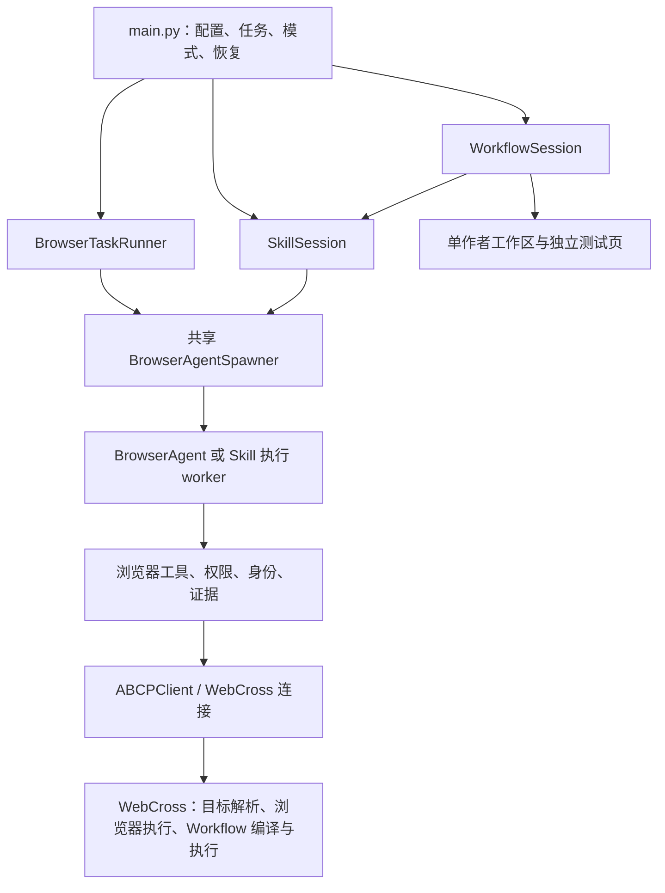

# 从用户请求到执行回执

更新：2026-10-12。本文按当前工作区源码说明 Browser、Skill 和 Workflow 三种运行入口及共享底层。Lead 模式、Lead 规划工具和独立 PlanValidator 运行时已删除。旧链路及原代码行号保存在[历史架构快照](end-to-end-request-flow-legacy-lead.md)。

本文记录源码职责，不证明正在运行的 Harness 已加载这些改动，也不把平台工作区源码等同于已安装 WebCross。CLI 用法见 [README](../README.zh-CN.md#运行入口)，源码模块职责见 [Harness 目录说明](../harness/README.md)。

## 入口与模式

CLI 由 [main.py](../main.py) 加载 [runtime_config.py](../runtime_config.py) 的配置，解析任务、模式、显式 Skill 选择与恢复参数。`harness.agent_mode` 只接受 `browser`、`skill`、`workflow`；交互入口包含 `/browser`、`/workflow [task]` 和 Skill 命令。

| 模式 | CLI 分派与主要对象 | 任务模型连接 | 主要职责 |
| --- | --- | --- | --- |
| Browser | `main._run_cli_impl` → `BrowserTaskRunner` → `BrowserAgent` | `worker` | 直接执行原始用户请求；BrowserAgent 管理执行上下文、观察、工具调用和完成复核 |
| Skill | `run_skill_cli` → `SkillSession` | `skill_orchestrator`；未配置时复用 `worker` | 绑定一个已发布 Skill 版本和本轮输入，执行已决定的 Workflow 步骤，处理语义分支与恢复 |
| Workflow | `run_skill_cli` → `WorkflowSession` | `skill_orchestrator`；未配置时复用 `worker` | 在任务工作区开发、运行和验证可复用程序，管理独立 trial 与交付源包 |

模型连接的实际选择集中在 [model_config.py](../harness/runtime/model_config.py)。Browser worker 和独立草稿入口 使用 `worker`；Workflow 主 Agent 和 Skill Orchestrator 可以配置自己的连接。

图中的 `WorkflowSession → SkillSession` 表示实现继承和复用；一次 Workflow 任务只有自己的主编排循环，不会再启动一个独立 Skill 主 Agent。

## Browser：直接执行原始任务

实现入口是 [browser/task.py](../harness/agents/browser/task.py)。`BrowserTaskRunner` 负责启动、派发、收集、恢复和持久化，不承担一个额外的模型规划循环。

1. CLI 创建任务记录、运行记录和锁，保留原始用户任务及明确的 `@Fleet` 引用。
2. 新任务经 `_submit_direct_plan` 登记一个 `direct_worker` phase，目标和 worker 指令来自原始用户请求。这里的 `task_plan`／`phase` 是共享持久化格式，不会调用已删除的 Lead 计划工具或 PlanValidator。
3. `BrowserTaskRunner.spawn` 调用共享 `BrowserAgentSpawner.spawn_browser_agent`。spawner 处理槽位、Fleet、页面归属、连接和 worker 生命周期。
4. [BrowserAgent](../harness/agents/browser/agent.py) 进入 [browser/loop.py](../harness/agents/browser/loop.py) 的模型与工具循环。模型读取观察、执行任务，并在需要时使用独立证据复核。
5. `BrowserTaskRunner.wait` 通过同一个 spawner 收集结果。CLI 保存结果与产物交付回执，显示答案、失败原因和可用的恢复信息。

原始任务仍决定业务目标。`direct_worker`、`delegated`、phase id 和 worker contract 等内部名称用于存量 Browser 任务恢复及共享账本，不能据此推断 Lead 运行时仍存在。

## Skill：绑定版本、执行程序、处理恢复

实现入口是 [skill_runtime/cli.py](../harness/skill_runtime/cli.py) 和 [skill_runtime/session.py](../harness/skill_runtime/session.py)。

- CLI 选择并绑定已发布 Skill 的 id 和不可变版本 hash；恢复时保留保存的版本。
- `SkillSession` 使用自己的模型上下文和持久状态，读取本轮目标、输入、计划、执行回执及待处理事项。
- 已决定的步骤由执行服务连续运行。服务复用 spawner 的槽位、页面租约和传输，执行这些操作本身不启动 Browser 模型循环；实现见 [executor.py](../harness/skill_runtime/executor.py)。
- `delegate_browser` 只把一个明确的页面子目标交给 Browser worker，证据和回执返回当前 Skill 会话。
- Workflow 主 Agent 直接编辑任务工作区；`/skill` 复用通过 Browser 完成有界操作，源码修订交给 `/skill-edit`。发布仍需用户命令。
- 结束提案使用原始目标、当前版本、执行事实和独立审查回执。审查可以要求继续、提出必要的人类决策或支持结束；处理代码见 [terminal.py](../harness/skill_runtime/terminal.py)。

这些工具由当前 Skill 会话注册和执行，不依赖已删除的 Lead 工具或根目录兼容导入壳。

## Workflow：开发与验证源包

[WorkflowSession](../harness/workflow_mode/session.py) 继承 Skill 会话的执行、证据、恢复和结束协议，并增加开发工作区、当前源码执行、隔离测试页面及独立 trial 状态。

主 Agent 可以在自己的开发工作区读取和修改源文件，以当前保存的源码版本运行 Workflow。同一个主 Agent 在独立页面试运行同一份源码，测试拥有单独的检查点与回执；不再创建 Builder 子任务或合并另一份源码。测试页面与业务页面的归属由已有租约和身份机制约束。

Workflow 结束后返回任务结果和 `packageRef`。把任务源包转成正式 Skill 使用 Skill Builder 的包装／发布流程；结束 Workflow 任务本身不等同于发布 Skill。命令与文件合同见 [Skill 使用说明](../skills/README.md)。

## 共享调用链与责任边界

| 层 | 实际模块 | 职责与证据 |
| --- | --- | --- |
| 模式与任务生命周期 | `main.py`、`agents/browser/task.py`、`skill_runtime/cli.py` | 模式选择、任务身份、运行锁、记录、取消和收尾 |
| worker 与 Fleet | `spawner/`、`fleet/` | worker 启动和收集、槽位、Fleet 与页面归属、租约及恢复服务 |
| Harness 工具与 Workflow 包装 | `tools/browser_tools/`、`workflow/`、`skill_runtime/` | 调用合同、文件权限、身份绑定、证据引用和执行回执；源包执行使用共享调用边界 |
| 连接与协议客户端 | `abcp_client.py`、`webcross_connection.py` | 连接发现、JSON-RPC 请求与响应、平台通知、传输错误及关联信息 |
| WebCross | 平台源码与实际安装实例分别核对 | 目标解析、原生页面／输入操作、观察生成、Workflow 编译及浏览器执行 |
| 模型 | `llm/` 与各模式模型循环 | 根据原始目标、授权和可验证事实判断业务路径、恢复动作及完成情况 |
| 持久化与诊断 | `storage/`、`events/`、`evidence/`、`results/` | 保存请求、响应、产物、用户补充、版本身份与结果，支持审查和追溯 |

一次调用应按请求、响应、时序和执行版本定位责任层。连接成功不证明业务操作完成；Workflow 的执行成功也不能单独证明用户目标完成。身份、权限、协议和不变量校验由已有机械层承担，业务路径和证据语义由模型结合原始目标判断。

平台协议依据、工作区版本和安装实例测量记录见 [WebCross 同步记录](webcross-v097-harness-migration.md)。其中的测量日期属于原验证，不代表本文重新测试过部署实例。

## 恢复、收尾和历史兼容

Browser 恢复读取保存的任务、phase、用户补充及既有页面身份；Skill／Workflow 恢复读取本模式 manifest、绑定版本和执行状态。已派发但没有确定回执的步骤保留不确定状态，不把进程重启当作动作未发生的证明。

各入口在退出时关闭或收集任务自己的执行服务和 worker，记录最终状态，并关闭存储、释放运行锁。任务结果包含的业务状态、清理错误和产物导出问题应分别保留，便于用户判断实际完成情况。

历史事件中的 `actor_type="lead"` 和 `lead_agent-*-final-context.json` 文件名仍可用于读取旧记录。历史 Lead 任务不会通过已删除的运行时继续执行。根目录 `agent_harness.py` 已删除，源码、测试与维护脚本直接导入实现模块。

最新事件产生点、消费点和平台目录证据由 [event-catalog.md](event-catalog.md) 自动生成。旧审计和性能测量中的 Lead 引用属于历史事实，不是现行入口或待恢复的功能。
