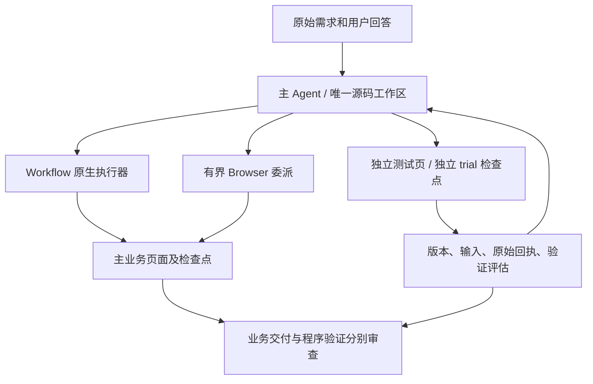

# Workflow 与 Skill 的共享执行循环

更新：2026-10-12。当前实现以本文为准；原双 Agent Builder 方案已经撤销。

## 1. 目标与范围

目标是复用已经验证的程序，减少重复探索、模型决策及端到端耗时，同时保留真实业务效果、原始证据和权限边界。Workflow 数量或覆盖比例不作为成功标准。

| 入口 | 主要职责 | 交付 |
|---|---|---|
| `/browser` | 直接完成浏览器任务 | 业务效果和执行记录 |
| `/workflow` | 一个主 Agent 编写、执行、观察、修正程序；在独立测试页验证 | 主任务结果、可复用源码、验证证据及限制 |
| `/skill <名称>` | 按已发布编排完成本轮任务，可委派 Browser 完成适用子目标 | 业务结果；缺陷和适配证据供后续编辑 |
| `/skill-create @<任务ID>` | 读取 Browser / Workflow / Skill 来源记录，创建草稿 | 可编辑草稿 |
| `/skill-edit <引用> [--source @<任务ID>] 建议` | 基于原文件和新证据修订、试运行 | 同一草稿的新版本 |

Workflow 模式不再派发 Builder 子 Agent。已删除调度、兜底派发、消息、等待、合并及其提示与工具。旧任务的源码、日志和回执保留，恢复时不会重新启动历史 Builder。

不引入验证轮数预算、max steps、“一轮无进展就停止”或单站点业务门禁。不做 Lead 协同、Python/shell 共享沙箱和本轮之外的存储改造。

## 2. 核心与应用层

继续使用已适配的 Tau 核心，不从头重写 Agent 引擎，也不引入另一套构建编排者。

- `harness/runtime/agent_loop.py`：Workflow、Skill 和草稿入口共用的模型循环、工具执行、上下文压缩与进度事件。
- `harness/skill_runtime/`：编排合同、原生执行器、页面绑定、回执、恢复、业务询问和收尾审查。
- `harness/workflow_mode/`：主作者工作区、版本激活、独立验证上下文；没有后台 Builder。
- `harness/skill_builder/`：草稿目录/索引、来源日志、文件编辑、平台合同、试运行、发布入口的适配层。保留类名不代表仍有第二个模型角色。

2026-10-14 补齐：共享循环将模型输出截断作为可恢复事件，保存原响应、跳过截断工具调用并在同一上下文继续；循环返回本身不再触发 Builder 完成。草稿入口复用 `runtime/program_validation.py` 的阶段源码/合同与证据记录，新增指定授权 Fleet 的独立测试页、原生观察和阶段判断入口。具体行为、回归和部署限制见 [builder-stop-and-validation-recovery.md](builder-stop-and-validation-recovery.md)。

`/skill-create` 与 `/skill-edit` 保留自己的草稿身份、历史上下文和发布状态，使用同一循环及同一执行器完成“改文件 → 试运行 → 观察 → 修正”。草稿保存与业务完成是不同的收尾动作，不能混用。

## 3. 一个作者，两份执行状态

主 Agent 优先处理业务交付，决定何时验证。没有后台竞争作者或合并等待。每次试运行冻结当前工作文件；修复只修改同一个工作区，下一次试运行记录新的版本。

### 验证操作

1. `create_workflow_test_page` 创建授权 Fleet 中的独立页，保留主页面绑定。
2. `run_skill_trial` 运行当前工作区的编排。`prepare_only=true` 先建立 trial 和检查点而不执行，便于观察或委派 Browser 建立前置状态。
3. `read_trial_state`、`inspect_trial_page` 读取试验状态与页面；`read_validation_receipt` 读取所属 trial 回执，并导入带来源的证据供主任务审查。
4. `resolve_trial_step` 核对副作用后选择完成、跳过或重试；再次调用 `run_skill_trial` 继续同一试验。
5. `activate_workflow_revision` 按当前工作区 hash 保存已验证修订、更新编排但不执行主页面；不会为了交付新源码而重跑业务。
6. `record_workflow_validation` 记录阶段评估：`verified / needs_work / blocked / not_applicable`；未评估保持显式未知。源码及合同 hash 改变后，旧评估不再匹配当前版本。

源码 hash 只证明版本身份。实际路径、业务效果、输入变化是否有代表性，由模型根据回执判断。Browser 补做不能证明未执行的 Workflow 正确。正式 `kind=browser` 阶段可以属于可复用混合编排。

相同 URL 不代表相同登录、对象、数据、浮层或业务起点。主 Agent 根据原始目标、输入、阶段说明、依赖及页面事实建立前置条件；Harness 不推导业务依赖。新页面不重置服务端数据、不扩大权限。

### 起点变化与恢复

- 先观察当前页面及已经完成的效果。
- 可用 `investigate_skill_trial` 委派 Browser 关闭已确认的浮层、恢复控件或完成有界子目标；也可保存恢复程序，通过 `run_trial_recovery` 执行。
- `resume_trial_recovery` 从保存的入口发起新调用，可传本次剩余输入；不是继续失败的 JavaScript 栈。完整业务输入继续保留在编排中。
- 无法可靠恢复起点时，主 Agent 可新开独立页并用 `new_trial=true` 建立新试验，重建必要前置条件。旧页和旧回执保留，主页面完成状态不得复制到新页。
- 源码改变不会自动重放已有副作用；已完成阶段的合同变化需要明确核对。

## 4. Browser Agent 的场景与委派合同

以下情况可以直接委派，不要求先让 Workflow 失败：

- 需要视觉或语义判断，而当前程序没有可靠处理方法。
- 不熟悉的特殊控件、一次性操作，或当前任务不值得程序化的部分。
- 意外浮层、页面跳转、局部操作完成后的不确定状态。
- 程序暂不支持的有界操作，优先完成用户业务。
- 对原始回执、页面效果的复杂调查。

简单读取可用原生观察；已知且重复的操作优先复用程序。不存在“所有流程必须写成 Workflow”的规则。

正式编排支持 `workflow → browser → workflow`。执行器在 Browser 阶段返回主 Agent，主 Agent 用 `delegate_browser` 派发，检查回执后用 `resolve_skill_step` 接受结果，再继续后续程序。临时恢复也走同一合同，保留恢复原因及原失败证据。

委派沿用原 Lead/现有 Worker 的分层回执和 continuation 协议：

| 方向 | 内容 |
|---|---|
| 主 Agent → Browser | 有界目标、目的、预期观察、阶段/合同、输入、页面/Fleet、版本、已有检查点、起点及证据 |
| Harness 附带 | 原始用户需求、已归属的用户回答、实际权限和页面租约 |
| Browser → 主 Agent | 结果、已执行动作、观察到的效果、当前页面状态、原始回执、未完成/未知副作用、阻塞及下一步 |

同一页面一次只有一个控制者；委派前释放原生执行器。Browser 可以询问用户，但不能自行改变业务约束或扩大授权；子目标完成不会结束整个任务。Harness 检查引用、身份、权限及状态；主 Agent 判断业务是否满足和下一步路径。

页面范围不匹配时返回带原因的拒绝，由主 Agent 核对 Page.list 和页面事件后重新绑定。不会以提示词或 Runtime.evaluate 绕过 WebCross 的协议/浏览器缺陷。

## 5. 收尾与已知限制

`finish_skill` 提交两项：

- `remaining_work`：未完成的用户业务。
- `known_limitations`：程序缺陷、未验证或受阻的路径。

独立审查核对原始目标、用户回答、实际效果、当前源码与验证证据。已完成业务可与如实披露的程序限制并存；限制是否影响本次交付由语义审查判断。不能把必要业务遗漏改名为程序限制，也不要求所有可选路径零缺陷才停止。

审查可继续处理、询问用户或接受结束。预算耗尽、停止自动续跑、结构完整、工具返回成功均不能直接推导业务完成。

## 6. 草稿、源码和兼容

- 正式源码、混合编排和 Skill 元数据保存在草稿工作区；发布仍由 `/skill-publish` 明确执行。
- `/skill` 只列已发布 Skill，`/skill-draft` 列草稿；`/skill-show` 查看源码及 Workflow。
- Workflow 来源按 hash 导入原源码，不根据总结重新生成；Browser 来源生成的新程序需要在真实环境验证实际操作。
- 草稿和中间产物继续位于任务 worktree 中并有 SQLite 索引；已发布内容继续在根目录 `skills/`。
- 发布覆盖 `skills/<名称>/`，不再生成发布历史目录或历史版本记录，也不要求递增版本号；保留原字段和内容 hash。
- 任务使用的源码固定在 `worktree/<任务ID>/skill/sources/<hash>/`，SQLite 的 `skill_task_sources` 索引负责恢复及修复引用。旧发布快照先迁移引用，再清理；切换前先退出旧 Harness 进程。
- 历史回执继续保留。旧 Builder 任务可作为授权来源记录读取，不再作为正在运行的角色恢复或自动合并。

## 7. 验证与性能判断

运行中可直接输入用户引导，或使用 `/guide <内容>`；HITL/授权回答使用 `/answer <编号> <回答>`。共享输入作用于主 Agent、Browser 与 Reviewer，旧工具决策和旧目标的完成结论不能绕过新输入。详细规则见 [runtime-user-steering-plan.md](runtime-user-steering-plan.md)。

回归覆盖：独立页隔离、同页继续与新页重测、源码变化后的副作用核对、浮层恢复与中断、权限/证据归属、混合编排、带限制收尾、草稿编辑发布、上下文恢复及共享循环。

性能收益需要下一轮可比真实任务验证。统计主 Agent 和 Browser 的总调用、`cache_read`、`cache_creation`、`uncached_input`、输出 token、平台 I/O、失败重试与排除人工等待后的端到端耗时，同时记录业务完成度与验证范围。不以删除角色、减少工具调用或缩小单次返回量直接宣称节省比例。
